# SPECTRE-SIGNAL

[](https://github.com/zazieproductions/spectre-signal/actions/workflows/validate.yml)
[](#security-and-privacy)
[](#architecture)
[](#deployment)
[](#license)
[](https://zazieproductions.github.io/spectre-signal/)

**Live site:** <https://zazieproductions.github.io/spectre-signal/>

A browser workbench for comparing **what an audio file contains** with **what it sounds like**. Inspect the file bytes, listen through a filter, and watch the spectrum change without changing the file. A built-in synthetic WAV lets you try both views without supplying a recording.

SPECTRE-SIGNAL was extracted from the [SONIC-GHOST prototype](archive/sonic-ghost-original.html). “SIGINT”, “C2” and “threat” are inherited interface labels. The app synthesizes and inspects local signals; it does not intercept communications, transmit commands or establish forensic attribution.

## Contents

1. [Screenshots](#screenshots) · [Quick start](#quick-start) · [First inspection](#first-inspection)
2. [Experiment gallery](#experiment-gallery) · [Palette memory](#palette-memory) · [Filter comparison](#filter-comparison) · [Spectral text](#spectral-text) · [Tones and bytes](#tones-and-bytes)
3. [Control reference](#control-reference)
   - [Inputs and transport](#inputs-and-transport)
   - [DSP and display](#dsp-and-display)
   - [Byte and tone inspectors](#byte-and-tone-inspectors)
4. [Preset reference](#preset-reference) · [Filter topologies](#filter-topologies) · [Waterfall palettes](#waterfall-palettes) · [Generated specimen](#generated-specimen)
5. [Architecture](#architecture) · [Performance](#performance)
6. [Accessibility](#accessibility) · [Security and privacy](#security-and-privacy)
7. [Deployment](#deployment) · [Testing](#testing) · [Contributing](#contributing) · [License](#license)

## Screenshots

**Playback.** The built-in 6.5-second WAV playing in Chromium. The waveform spans the whole file; the FFT bars show the spectrum at the playhead, and the waterfall shows its recent history.

[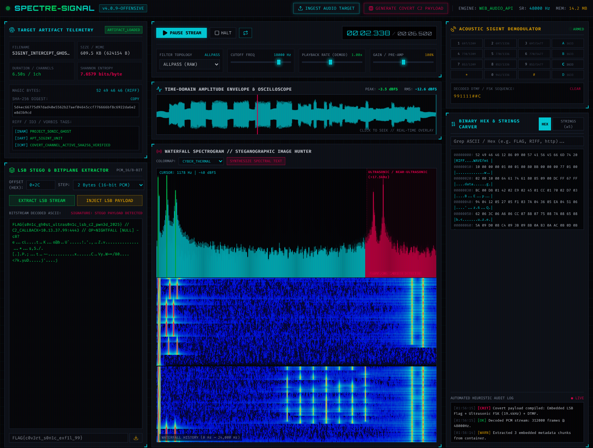](docs/screenshots/workbench-playback.png)

**Two ways to read the built-in WAV.** Search `RIFF` in **HEX** to see the header bytes at the start of the file. Search `PROJECT` in **STRINGS (≥5)** to find a tag near the end. Both views report file offsets, not playback times.

| HEX · `RIFF` | STRINGS · `PROJECT` |
| --- | --- |
| [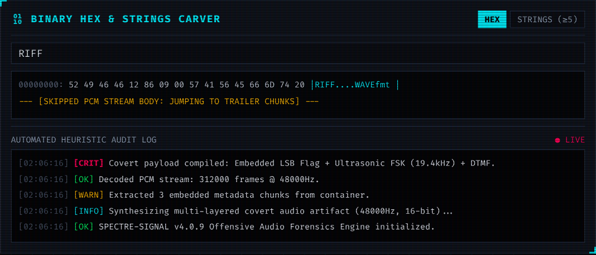](docs/screenshots/hex-header.png) | [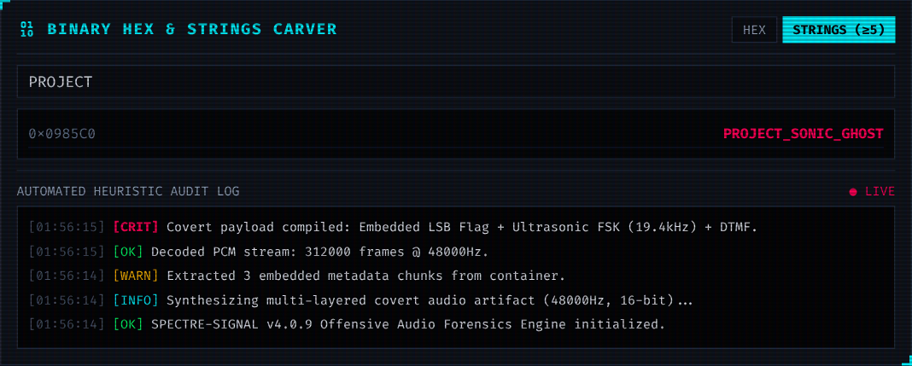](docs/screenshots/strings-inspector.png) |

## Quick start

You need a modern browser with Web Audio, Canvas 2D and Web Crypto, and a static file server (Python 3 works). **No npm install, build, API key or backend.** The current page needs network access for Tailwind CSS, Lucide and Google Fonts.

```sh
git clone https://github.com/zazieproductions/spectre-signal.git
cd spectre-signal
python3 -m http.server 8000 --bind 127.0.0.1
```

Open **<http://localhost:8000/>**. On Windows, `py -3 -m http.server 8000 --bind 127.0.0.1` is the equivalent launcher command. Use localhost or HTTPS rather than an insecure LAN URL: hashing requires a secure context. Stop the server with Ctrl+C.

### First inspection

1. Wait for **ARTIFACT_LOADED** and a **6.50s / 1ch** duration. On load, the app generates `SIGINT_INTERCEPT_GHOSTC2.wav` but does not start playback. The first four bytes, `52 49 46 46`, spell `RIFF`.
2. Start with low speaker volume or lower **GAIN / PRE-AMP**. Select **ENGAGE STREAM**. The playhead moves over the waveform; the FFT bars and waterfall show the signal *after* the filter and gain. Try **LOWPASS** and move **CUTOFF FREQ** down. The spectrum changes; the SHA-256 digest does not.
3. Select **HALT**, then **STRINGS (≥5)** and search for `PROJECT` to find a printable marker in the generated file. The LSB panel is a different view: it reads bits, not contiguous text. Neither result by itself proves anything about an unknown file.
4. To inspect your own short, trusted sample, choose **INGEST AUDIO TARGET** or drop a file onto the page. Browser codec support varies; start with PCM WAV. This replaces the working specimen, not the file on disk.

## Experiment gallery

These panel close-ups were captured in Chromium using synthetic WAVs. Open a plot for the full-size image. To try the experiments silently, mute your speakers rather than setting the workbench gain to zero: the analyser reads the signal *after* gain.

### Palette memory

One tone rises while another falls. Where their pitches meet, they draw an X. Loop the [one-second crossed sweeps](docs/TESTING.md#crossed-sweeps-for-the-gallery) at 1× in **ALLPASS**. Switch **COLORMAP** from **CYBER_THERMAL** to **MATRIX_PHOSPHOR** to **INFERNO_RADAR**, leaving time for a few rows between switches.

[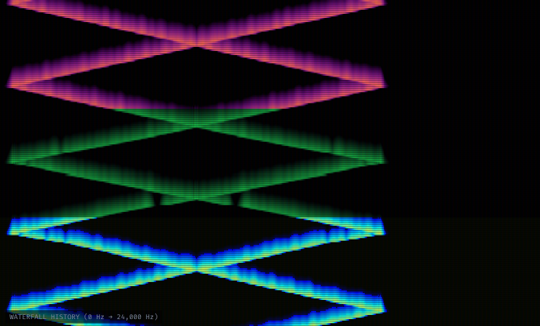](docs/screenshots/palette-history.png)

Read this capture **bottom to top**: each new row uses the selected palette, while older rows keep their colors. The colors change mid-sweep; the pitches don't jump.

### Filter comparison

Keep the sweep file loaded. Set **CUTOFF FREQ** to **1,200 Hz** and use **MATRIX_PHOSPHOR** for both runs. These captures are paused about **0.10 s** into the loop at 1× and 100% gain. Change only **FILTER TOPOLOGY**: the higher-frequency peak on the right drops almost to the floor in **LOWPASS**, while the lower peak on the left remains. The file digest stays the same.

| ALLPASS · reference | LOWPASS · attenuate the high end |
| --- | --- |
| 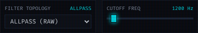 | 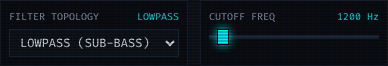 |
| [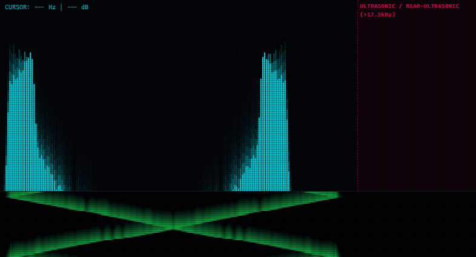](docs/screenshots/filter-allpass.png) | [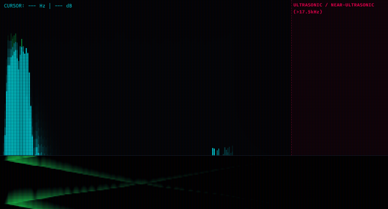](docs/screenshots/filter-lowpass.png) |

### Spectral text

Return to **ALLPASS** at **1×**, choose **INFERNO_RADAR**, then open **SYNTHESIZE SPECTRAL TEXT**. Enter `XOX` and compile. This makes a new local specimen, `SIGINT_INTERCEPT_XOX.wav`. Pause near **6.2 s** to see the three groups of strokes. Frequency runs across the waterfall; the successive columns of each glyph appear over *time*, not as a horizontal line of type.

| Input · spectral word | Output · detail around the 9.5–15.2 kHz glyph tones |
| --- | --- |
| [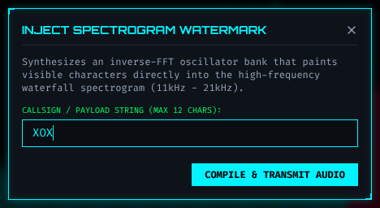](docs/screenshots/spectral-text-dialog.png) | [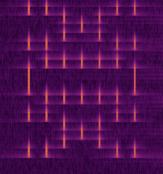](docs/screenshots/spectral-xox.png) |

### Tones and bytes

| Recognize a keypad tone | Recover a test label |
| --- | --- |
| [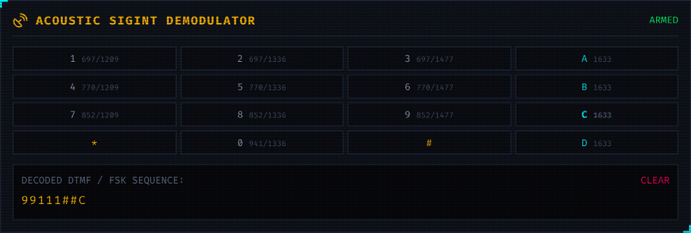](docs/screenshots/dtmf-tone.png) | [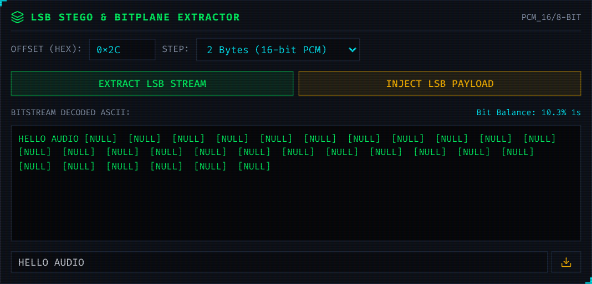](docs/screenshots/lsb-readback.png) |
| Play the built-in specimen and pause near **2.4 s**. The 852 Hz row and 1,633 Hz column match **C**. Held tones can register more than once; the sequence is a heuristic readout. | On the [silent control WAV](docs/TESTING.md#a-reproducible-control-file), enter `HELLO AUDIO` and choose **INJECT LSB PAYLOAD**. Re-extract with the default offset and step: the preview starts with the label. You're reading the newly encoded WAV, not the original silence file. |

## Control reference

### Inputs and transport

| Control | Initial state or input | Result |
| --- | --- | --- |
| INGEST AUDIO TARGET / drop | Local file picker (`audio/*`) or first file dropped on the window | Stops playback, inspects the bytes and asks the browser to decode a copy. Does not auto-play the import. |
| GENERATE COVERT C2 PAYLOAD | Built-in specimen | Replaces the working file with a fresh synthetic WAV and plays from the start. |
| ENGAGE STREAM / PAUSE STREAM | Stopped at `00:00.000` | Starts playback from the current offset; press again to pause. Starting or resuming clears the decoded tone sequence. |
| HALT | Button | Stops playback and resets the time and playhead to zero; keeps the file loaded. |
| Toggle Loop (repeat icon) | **On** | Repeats the buffer; can change during playback. With looping off, use HALT to reset the UI after the sound ends. |
| Waveform | Click a horizontal position | Seeks by fraction of total duration; restarts the source there if playing. The envelope itself is a static view of channel 0. |

### DSP and display

| Control | Choices or default | Result |
| --- | --- | --- |
| FILTER TOPOLOGY | Five [topologies](#filter-topologies); **ALLPASS** | Selects the playback biquad; does not change the cutoff slider. |
| CUTOFF FREQ | 60–22,000 Hz, step 1; **18,000 Hz** | Sets the cutoff or center frequency, depending on topology. Q is fixed at 2.5. |
| PLAYBACK RATE (DEMOD) | 0.10–2.00×, step 0.05; **1.00×** | Changes speed **and** pitch, not a pitch-preserving time stretch. |
| GAIN / PRE-AMP | 0–200%, step 1; **100%** | Scales sound and analyser input. Levels above unity can clip on output. |
| FFT cursor | Move the pointer over the bars | X maps to frequency, Y to a dB scale; the cursor is a coordinate readout, not a measured peak. |
| COLORMAP | Three [palettes](#waterfall-palettes); **CYBER_THERMAL** | Changes the colors of new waterfall rows, not the samples. |
| SYNTHESIZE SPECTRAL TEXT | Opens the watermark dialog | Edit the callsign (up to 12 characters) or use the × button to close without generating. |
| COMPILE & TRANSMIT AUDIO | Dialog action | Generates a **replacement** specimen with the entered word and plays locally from 3.1 s. Nothing is transmitted. |

### Byte and tone inspectors

| Control | Choices or default | Result |
| --- | --- | --- |
| COPY (SHA-256) | Digest of the current file bytes | Writes the digest to the system clipboard if permitted. |
| OFFSET (HEX) | **`0x2C`** (44 bytes) | Starting byte for extraction. Correct for the built-in WAV's data layout, not a universal WAV header size. |
| STEP | 1, **2** (16-bit PCM), or 4 (labeled 32-bit float) bytes | Byte stride for extraction; the app does not infer sample format from this choice. |
| EXTRACT LSB STREAM | Automatic on ingest; button reruns | Reads the low bit at each step and displays printable characters or placeholders. The bit balance/signature label is a heuristic. |
| Text field / INJECT LSB PAYLOAD | Short ASCII test text; blank uses `FLAG{injected_by_sonic_ghost}` | Encodes decoded channel 0 into a **new mono PCM16 WAV** with test text and new metadata, then loads it. Offset and step are reader controls, not encoder settings. |
| Download Modified WAV (download icon) | Current working bytes | Downloads those bytes under the displayed filename. Not a recording of the DSP output: an untouched import is **not** transcoded, even though the Blob type is `audio/wav`. |
| HEX / STRINGS (≥5) | **HEX** initially | Switches between 16-byte head/tail rows and printable ASCII runs of at least five characters with offsets. |
| Grep ASCII / Hex | Empty search | Case-insensitive substring filter, not a regex: ASCII or spaced hex in the preview rows, or text in the carved strings. Clear the field to reset. |
| CLEAR (tone sequence) | Decoded DTMF display | Clears displayed symbols, not the audio. The 4×4 tone matrix is an **indicator**, not a playable keypad. |

**Reading the panels:** filename, size, magic bytes, entropy and tags describe the working bytes; duration and sample rate come from the decoded audio. Peak/RMS and the tone sequence start with example values until playback. The **MEM** badge is static text, not a profiler. Audit entries pair color with text: cyan `INFO`, green `OK`, amber `WARN`, red `CRIT`. These are not verified security findings.

## Preset reference

There is no saved preset bank. The built-in choices are the filter topologies, waterfall color maps and specimen actions below. DSP settings affect listening and live analysis only.

### Filter topologies

| Menu label | Web Audio type | What to listen for |
| --- | --- | --- |
| ALLPASS (RAW) — default | `allpass` | Passes all frequency magnitudes; an all-pass filter can still shift phase. |
| HIGHPASS (ULTRASONIC) | `highpass` | Attenuates frequencies below cutoff. The name does not set a particular band. |
| BANDPASS (ISOLATE C2) | `bandpass` | Emphasizes a band around the selected center frequency. |
| LOWPASS (SUB-BASS) | `lowpass` | Attenuates frequencies above cutoff. |
| NOTCH (KILL CARRIER) | `notch` | Rejects a band around the selected center frequency. |

### Waterfall palettes

| Menu label | Value | Level encoding |
| --- | --- | --- |
| CYBER_THERMAL — default | `cyber` | Dark low bins through cyan/green to warm highlights |
| MATRIX_PHOSPHOR | `matrix` | Green-dominant intensity ramp |
| INFERNO_RADAR | `inferno` | Red/orange ramp with violet midtones |

### Generated specimen

| Trigger | Spectral word | Playback after generation |
| --- | --- | --- |
| Page load | `GHOST-C2` | Ready, stopped |
| Generate button | `GHOST-C2` | From 0 s |
| Compile in spectral text dialog | Field starts at `GHOST//C2`; empty falls back to `EXFIL-99` | From 3.1 s, just before the letters |

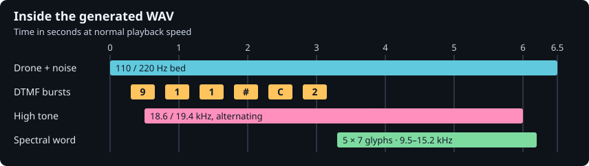

The encoder writes 48 kHz, mono, 16-bit PCM. The generator paints uppercase letters with rows of sine tones; unsupported glyphs become boxes. It also adds random noise, so two generations of the same word need not have the same hash.

## Architecture

The **raw bytes** (cyan) are what you inspect, hash and download; the decoded **AudioBuffer** (green) is what you hear. The **WAV encoder** (amber) creates new bytes when you generate a specimen or inject text. Playback filters never write back to the input.

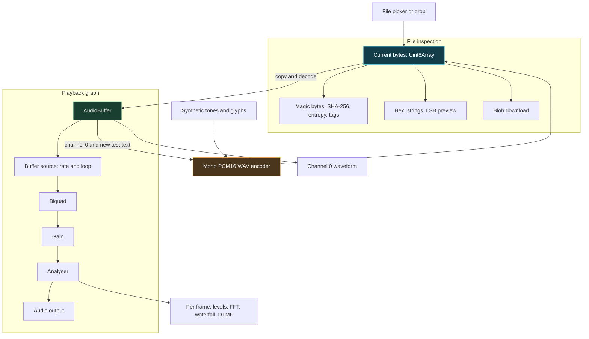

[`index.html`](index.html) defines the panels and loads the vendors. [`main.css`](src/styles/main.css) adds the grid and CRT styling. One deferred [`app.js`](src/scripts/app.js) owns the working buffers, audio graph, inspectors and DOM listeners; the archive is not loaded. See the [technical architecture](docs/ARCHITECTURE.md) for the transport lifecycle and how to interpret each analysis.

## Performance

Files are processed in memory, not streamed. Entropy and string carving visit the entire input; decoding needs a byte copy and a floating-point buffer. At 48 kHz, a minute of stereo decoded audio alone is about **22 MiB** (`48,000 × 60 × 2 × 4` bytes), before file bytes, strings or canvases. This is a size estimate, not a tested limit.

The hex view shows up to 70 head and 30 tail rows; the strings view displays the first 150 matches, **not** just the first 150 strings scanned. During playback each animation frame allocates analyser arrays and paints 256 bars plus a two-pixel waterfall row. Use short fixtures and HALT between comparisons. To compare machines, record the same file's size, duration and channel count; measure selection-to-waveform time and playback frame times at the same window size. Use browser profiling tools, not the MEM badge. There is no published throughput, frame-rate or maximum-file-size benchmark.

## Accessibility

Use Tab/Shift+Tab to move among native controls, Enter/Space on focused buttons and arrow keys on focused sliders. Filename, duration, levels, sequence, hex and strings have text readouts; none is a complete text equivalent of the canvases. Waveform seek and FFT hover are pointer-only. Some controls lack associated labels or visible focus, and the spectral dialog lacks focus management and an Escape handler. CRT scanlines and pulsing indicators have no reduced-motion switch. Zoom and the stacked layout can help with small text. No WCAG conformance or assistive-technology audit is claimed.

## Security and privacy

The application implements no file-upload endpoint, microphone capture, account or remote collection. **Local processing is not isolation**: the page loads third-party scripts and font resources, and some file-derived text is rendered as HTML. Use the generated fixture or trusted recordings you have permission to inspect, not hostile files or confidential evidence. Clipboard copies and downloads can outlive the page. Entropy, keyword hits, DTMF matches and high-band warnings are observations, not proof of hidden communications. See [security and private reporting](SECURITY.md) and the [research boundaries](docs/RESEARCH_ETHICS.md).

## Deployment

The project is published from the repository root through GitHub Pages at <https://zazieproductions.github.io/spectre-signal/> (branch `main`, `/` root). That site is built from `main`, so it updates after changes merge there.

Serve `index.html` and `src/` together from a static **HTTPS** origin, preserving their relative paths. There is no build output or application server to deploy. The shipped page is **not offline-ready**. See the [deployment guide](docs/DEPLOYMENT.md) for the file layout, GitHub Pages settings, external dependencies and post-deploy checks.

## Testing

From the repository root, run the same standard-library checks as [Validate](.github/workflows/validate.yml):

```sh
python3 -m unittest discover -s tests -p 'test*.py'
```

CI checks static structure, asset references and local documentation file links. It does not run a browser or validate DSP accuracy. The [testing guide](docs/TESTING.md) includes a reproducible silent WAV, expected observations and a manual playback, export and keyboard checklist.

## Contributing

Use the bug or feature form for non-sensitive reports. Include the browser/OS, the action you took and what you observed; prefer the built-in specimen to sharing a recording. Follow the [contribution guide](CONTRIBUTING.md) and use a private channel for security concerns.

## License

No `LICENSE` file or open-source license grant is supplied. Ask the rights holder for terms before redistributing the project; source visibility is not a license. Third-party libraries, fonts and recordings retain their own terms.
