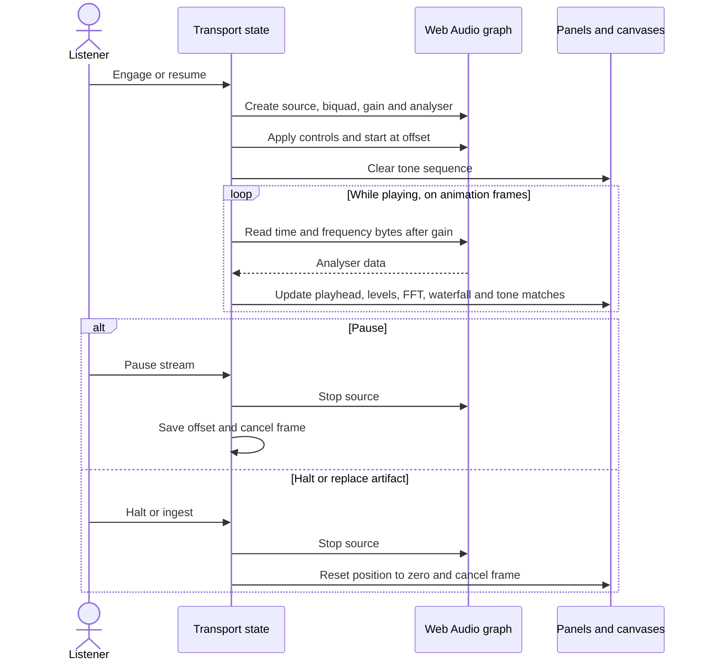

# Technical architecture

Start with the [signal-flow diagram](../README.md#architecture) for the file/PCM split. This is a structural extraction of a single-page prototype, not a set of independently loaded modules. Function names below refer to [`src/scripts/app.js`](../src/scripts/app.js).

## Runtime map

| Owner | Responsibility and lifetime |
| --- | --- |
| [`index.html`](../index.html) | Loads Tailwind, its inline config, fonts and Lucide; defines the panels, control IDs, initial values and canvases. `app.js` runs with `defer` after parsing. |
| [`src/styles/main.css`](../src/styles/main.css) | Grid background, decorative overlays, pulse animation and range styling; layout and panel visibility also rely on Tailwind utilities. |
| Page-level JS state | One `audioCtx` is reused. `rawFileBytes` and `audioBuffer` represent the current artifact; `extractedStrings` is rebuilt per ingest. No worker, server-side processing or session database. |
| Playback state | `sourceNode`, `filterNode`, `gainNode` and `analyserNode` are created on each start. `pauseOffset`, `startTime`, loop/play flags and an animation-frame ID coordinate transport with the UI. |
| [`archive/sonic-ghost-original.html`](../archive/sonic-ghost-original.html) | Historical single-file implementation. Not a dependency or a second deployment entry point. |

## Ingest and replacement

1. A picker/drop reads the first `File` in full via `arrayBuffer()`. On boot, **Generate**, or spectral text compilation, `generateCovertSample` instead synthesizes float samples, then `encodeWAVWithStegoAndMetadata` writes RIFF/WAVE bytes. The generated layout is `RIFF/WAVE → fmt → data → LIST/INFO` with mono little-endian PCM16 in the data chunk.
2. `ingestRawAudioBytes` stops playback and assigns the incoming `Uint8Array` to `rawFileBytes`. Magic bytes, Shannon entropy, SHA-256, tag scans, LSB preview, hex and printable strings are all computed from this representation, including container headers and metadata.
3. A **copy** of the byte range goes to `audioCtx.decodeAudioData`. On success, `audioBuffer` supplies duration, channel count and samples. The displayed sample rate is the **decoded** rate (decoding can resample to the context), not an independent measurement of the file header. `drawStaticWaveform` plots min/max values for channel 0 per horizontal pixel.
4. Inspecting or filtering does not change `rawFileBytes`. Injection calls the same encoder with decoded channel 0 and new test text, then re-ingests the result. It does **not** preserve stereo channels, original compression or source tags. Download wraps the current bytes in a Blob; it does not run the encoder or capture the audio graph.

The loaded badge and byte panels update **before** decoding completes. A codec failure can therefore leave those panels populated without a matching playable buffer. Wait for the duration and waveform; after a failed load, reload with a known PCM WAV rather than interpreting stale readouts.

## Transport lifecycle

A buffer source is single-use. `startAudio` builds a fresh graph even on resume or a seek during playback. Seeking while stopped just sets the offset and playhead. `pauseAudio` keeps an offset; `stopAudio` resets it. Pause/seek timing is approximate at non-unit rates (the saved offset and displayed elapsed time use different rate calculations). With loop off, there is no `onended` synchronization: the sound can finish while the animation still runs.

## What the panels actually measure

| Panel | Implementation | Interpretation limit |
| --- | --- | --- |
| Identity and entropy | First four bytes, SHA-256 over all bytes, and `−Σ p log₂ p` from a 256-entry byte histogram. Entropy above 7.4 bits/byte changes color. | A digest identifies bytes, not provenance. Compression alone can produce high entropy. |
| Tags | Searches decoded byte text for selected RIFF/ID3 markers such as `INAM`, `IART`, `TIT2` and `COMM`; displays at most 64 characters of a candidate value. | Not a chunk-aware RIFF, ID3 or Vorbis parser. Even the fallback “Standard RIFF/WAVE PCM” label is not format validation. |
| Hex and strings | Hex rows cover the head and tail, not the whole file. String carving scans all bytes for contiguous ASCII `0x20`–`0x7E` of length ≥5, records offsets, then filters and caps the display. | Keyword highlights are substring matches; neither a highlighted string nor its absence establishes intent. |
| LSB preview | Samples one low bit per selected byte stride, assembling groups of eight. Stops at end of input or about 240 display characters; non-printables become dots or a null marker. | Assumes a user-supplied byte layout. The reported fraction of ones or keyword hit is **not** a statistical chi-square test. |
| Peak / RMS | Estimates dBFS from the current window of byte time-domain data, downstream of gain. | Not full-file loudness or a calibrated sound pressure level. |
| FFT / waterfall | `fftSize = 2048`, 1,024 bins, smoothing 0.65. Bars sample the full range in 256 steps; the waterfall paints the lower 85% of bins, newest two-pixel row at the top. | At 48 kHz the FFT spans up to 24 kHz, but the waterfall only reaches about 20.4 kHz despite the fixed caption. History advances per animation frame, not on a calibrated time axis. |
| High-band alert | A threshold on the mean strength of the top 65 displayed bars. | An energy cue, not identification of a carrier or a decoded message. |
| Tone sequence | Finds the strongest row and column above a fixed FFT amplitude threshold, sampling the nearest bin and its neighbors. A changed key can append immediately; a held key can repeat after 320 ms. | Heuristic DTMF only. The generated alternating high tones are not decoded as FSK data; there is no Morse decoder. Filters, rate, gain and frame timing affect matches. |

The DTMF readout maps a **pair** of frequencies to a symbol. Cells highlight automatically; they are not input controls:

| Row Hz / column Hz | 1209 | 1336 | 1477 | 1633 |
| --- | --- | --- | --- | --- |
| 697 | 1 | 2 | 3 | A |
| 770 | 4 | 5 | 6 | B |
| 852 | 7 | 8 | 9 | C |
| 941 | `*` | 0 | `#` | D |

## Engineering limits and next steps

- Use the [manual checks](TESTING.md) today. Reference fixtures, calibrated DSP comparisons and automated browser smoke tests are still needed before making accuracy claims.
- Pure byte inspection and WAV encoding are candidates to extract from global DOM state. Decode errors and natural playback completion need explicit UI state transitions.
- Main-thread scans, per-frame allocations, retained strings/logs and download object URLs (not currently revoked) matter on long sessions. Measure before setting a file-size limit.
- Rendering file-derived text safely, pinning/self-hosting dependencies and then applying a tested CSP are prerequisites for handling less trusted inputs. See [Security](../SECURITY.md) and the [deployment guide](DEPLOYMENT.md).
- Keyboard equivalents for canvas interactions, labeled controls, modal focus handling and a reduced-motion mode remain open accessibility work.
